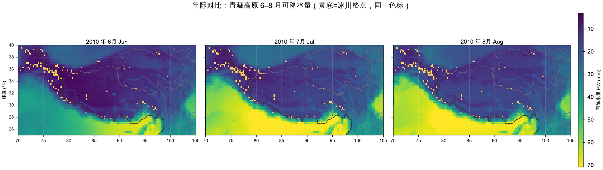
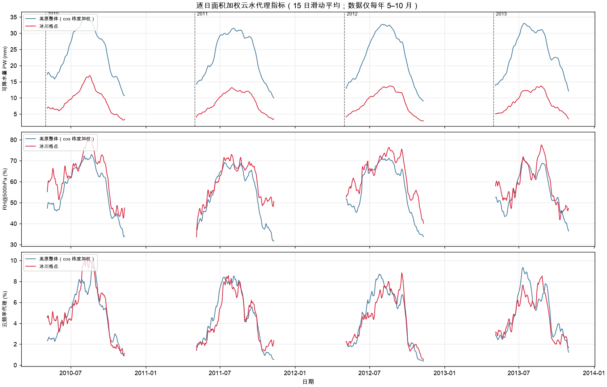
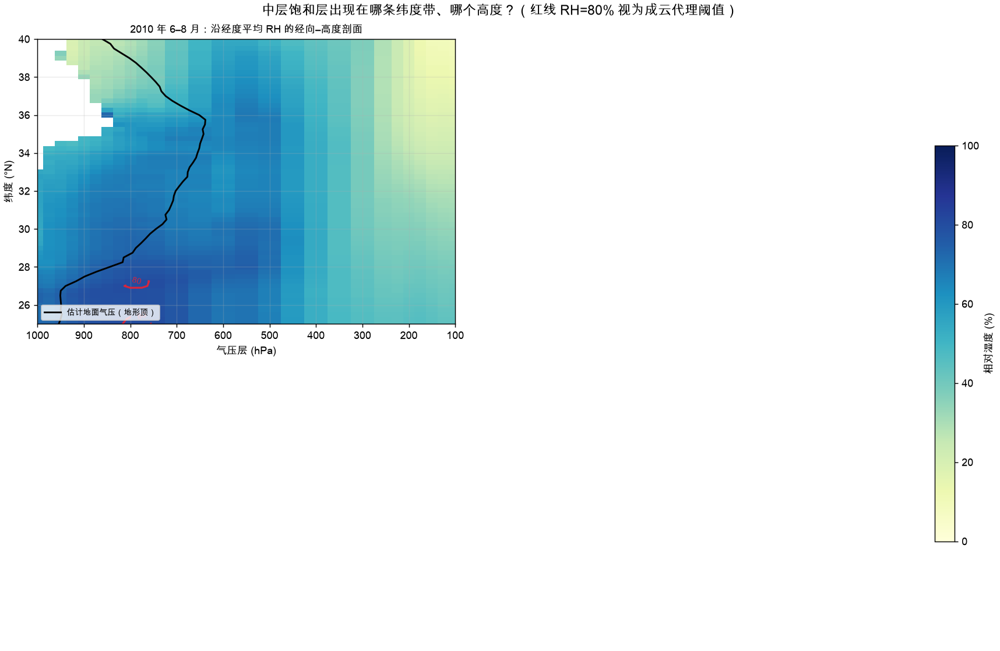
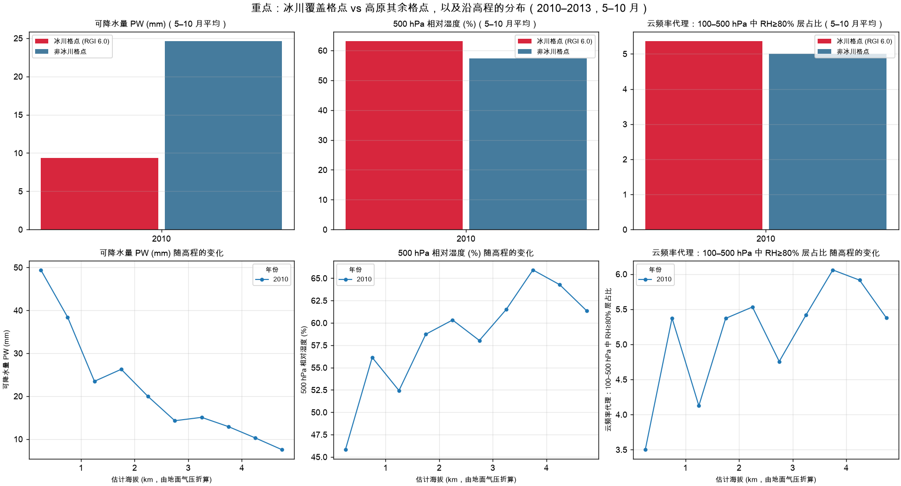

# HydroWeave — DBAS 数据管理与分析系统

DBAS（Data Management and Analysis System）面向个人科研工作流，管理 ERA5/NetCDF
数据的完整生命周期：**数据卷登记 → 目录索引 → 元数据解析 → 质量检查 → 区域裁切
→ CDS 下载管理 → 报告输出**。原始数据只读；所有运行状态写入项目内 `data/`；
任务支持分批、预算控制、重试与断点续跑。

> 当前版本 `0.1.0`。核心管理链路、CDS fetch、内容画像/QC 和 L1 subset 已实现；
> 更高阶 EDA 与特征工程仍在迭代中。

算法层已拆分到独立仓库 [dbas-core](https://github.com/Neiyako/dbas-core)
（包名 `dbas_core`），本仓库专注系统编排：卷管理、扫描调度、任务队列、下载
管理与 CLI。两仓库通过 Git 依赖组合，可各自独立演进。

---

## 一、系统能做什么

| 能力 | 说明 | 主要命令 |
|------|------|----------|
| 目录管理 | 以「卷 ID + 卷内相对路径」稳定定位文件，移动硬盘换挂载点不影响索引 | `dbas volume register/list` |
| 扫描与解析 | 先 inventory 盘点，再按任务队列解析 NetCDF 头（只读 header，不载入数据体）；支持增量扫描、预算、批次 | `dbas scan` |
| 校验与运维 | 文件可读性检查、流式 SHA-256、任务清理、SQLite integrity check 与在线备份 | `dbas verify/checksum/db` |
| 数据集与 QC | 按路径规则识别数据集，抽样画像，记录时间轴/fill 值/物理范围等 QC 证据 | `dbas dataset/profile/qc` |
| 区域裁切 | xarray+dask 惰性裁切，支持降序纬度、0–360 经度等 ERA5 轴约定，产物自动登记为 analysis 卷 | `dbas subset` |
| CDS 下载 | 小体量请求的 plan/enqueue/run 管链；`.part` 临时文件 + 原子改名 | `dbas fetch` |
| 报告 | 生成 Markdown 盘点/校验报告到 `data/reports/` | `dbas report` |

### 实际分析成果示例

系统已用于青藏高原云水资源代理指标分析（2010–2013 年 5–10 月 ERA5 气压层
t/q/u/v 数据，约 2TB 原始卷）。以下是真实产出的例图，由可复现实验层
[`experiments/tp_cloud_water`](experiments/tp_cloud_water/) 生成；算法口径见
该实验的 [`eda.py`](experiments/tp_cloud_water/eda.py) 模块注释：

**年际对比**——高原主体 PW（可降水量）、RH500（中层饱和度）、CFRAC（云发生
频率代理）的四年夏季平均空间分布与差异：



**逐日时间序列**——高原平均 PW 与 RH500 的夏季演变，可看到季风推进阶段的
水汽资源脉冲：



**沿 32°N 垂直剖面**——温度与相对湿度的纬度–气压分布，展示高原动力抬升
对中层湿层结构的影响：



**冰川区高程分层**——RGI 6.0 冰川栅格（13/14/15 区）内 PW 随海拔的分布，
用于讨论冰川补给区的水汽条件：



> 口径说明：本卷 ERA5 只有 t/q/u/v，没有云水混合比（clwc/ciwc）与总云量，
> 上述 PW/RH500/CFRAC 都是**代理指标**，不是真云水含量。地形以下填层按
> 「等值连段」法反推地面气压并掩膜，避免地下层水汽被误积分。完整口径见
> [`experiments/tp_cloud_water/eda.py`](experiments/tp_cloud_water/eda.py)。

---

## 二、安装

需要 Python 3.11+。安装主包时会从 GitHub 拉取 `dbas-core` 算法库，并钉在
已验证的 commit（见 `pyproject.toml`）；需要可审查的版本清单时另装
`configs/constraints-py313.txt`：

```bash
python3 -m venv .venv
.venv/bin/python -m pip install -e .

# 运行测试
.venv/bin/python -m pip install -e '.[dev]'
.venv/bin/python -m pytest
```

可选依赖组：

```bash
.venv/bin/python -m pip install -e '.[fetch]'   # CDS API 下载
.venv/bin/python -m pip install -e '.[eda]'     # subset / 画像 / 实验性 EDA
```

安装后优先使用 console script：

```bash
dbas --help
```

macOS 同步工具若导致 editable 安装的 `.pth` 失效（被加上 `hidden` 标志，
Python 3.13 的 `site.py` 会跳过），优先修复标志位；不想修就用备用入口：

```bash
chflags nohidden .venv/lib/python3.13/site-packages/*.pth
.venv/bin/dbas --help

# 备用入口（不依赖 .pth）
PYTHONPATH=src .venv/bin/python -m dbas --help
./bin/dbas --help
```

`bin/dbas` 是开发辅助启动器，默认使用项目内 `.venv`。

---

## 三、快速上手

### 30 秒体验（合成数据，不联网）

```bash
.venv/bin/python scripts/demo/make_demo_volume.py   # 生成合成 NetCDF
dbas volume register data/demo_volume --id demo     # 注册卷
dbas scan --volume demo --mode inventory --enqueue-metadata
dbas scan --volume demo --mode metadata             # 解析 NetCDF 头
dbas report inventory                               # 生成盘点报告
dbas status
```

体验类 ERA5 全球逐日数据的区域裁切（需 `.[eda]`）：

```bash
.venv/bin/python scripts/demo/make_demo_era_volume.py data/era_like_volume 3
dbas volume register data/era_like_volume --id eralike
dbas scan --volume eralike --mode inventory --enqueue-metadata
dbas scan --volume eralike --mode metadata
dbas subset plan --volume eralike
dbas subset enqueue --volume eralike
dbas subset run
```

### 接入真实数据盘

```bash
# 1. 注册：必须显式指定稳定 ID（跨重挂载不变）
dbas volume register /Volumes/ERA5HD --id era5hd

# 2. 先盘点，确认文件数符合预期，再入队解析
dbas scan --volume era5hd --mode inventory
dbas scan --volume era5hd --mode inventory --enqueue-metadata

# 3. 解析头信息：小预算试跑，中断后重跑同一命令即续跑
dbas scan --volume era5hd --mode metadata --budget 60 --batch-size 20

# 4. 数据集识别 → 画像 → QC
dbas dataset assign --volume era5hd
dbas profile --volume era5hd --limit 100
dbas qc run --volume era5hd
dbas qc report --volume era5hd

# 5. 校验与备份
dbas verify --volume era5hd
dbas checksum --volume era5hd --batch-size 5
dbas db check && dbas db backup
```

### CDS 下载

1. 在 [Copernicus Climate Data Store](https://cds.climate.copernicus.eu/) 注册并获取 API Key；
2. 凭证写入 `~/.cdsapirc` 或环境变量 `CDSAPI_URL`/`CDSAPI_KEY`，**不要提交**；
3. 始终先 plan 预览，确认时间范围、变量、区域与文件大小后再入队：

```bash
dbas fetch plan --config configs/fetch/era5_demo.yaml
dbas fetch enqueue --config configs/fetch/era5_demo.yaml
dbas fetch run --config configs/fetch/era5_demo.yaml
```

下载成功后文件自动登记到 `downloads` 卷并入队元数据解析——之后的
verify/checksum/metadata 流程与外接硬盘完全一致，这就是「下载测试管理链路」。

### 可复现实验层：云水代理 EDA

实验代码在 `experiments/<name>/`，配置驱动、按 `run-id` 分目录、年度断点续跑、
产物带 SHA-256 清单。没有外接盘时先用合成 fixture 验证整条链路：

```bash
# 合成试验台（不联网、不接触真实卷）
.venv/bin/python scripts/demo/make_tp_cloud_water_fixture.py /tmp/tp_fixture --days 3
PYTHONPATH=src:. .venv/bin/python -m experiments.tp_cloud_water.eda \
  --config /tmp/tp_fixture/config.yaml --run-id fixture
PYTHONPATH=src:. .venv/bin/python -m experiments.tp_cloud_water.plot \
  --config /tmp/tp_fixture/config.yaml --run-id fixture

# 真实卷：先确认外接盘在线、catalog 已 scan，再用同一 run-id 计算和制图
PYTHONPATH=src:. .venv/bin/python experiments/tp_cloud_water/eda.py \
  --config experiments/tp_cloud_water/config.yaml --run-id tp-2010-2013
PYTHONPATH=src:. .venv/bin/python experiments/tp_cloud_water/plot.py \
  --config experiments/tp_cloud_water/config.yaml --run-id tp-2010-2013
```

产物与恢复语义见 [`experiments/tp_cloud_water/README.md`](experiments/tp_cloud_water/README.md)，
运维操作见 [`docs/operations.md`](docs/operations.md)。

### 任务与运维

```bash
dbas tasks list --status pending        # 待办
dbas tasks show TASK_ID                 # 失败详情
dbas tasks prune                        # 清理已完成任务
dbas report inventory                   # Markdown 报告
dbas db check                           # SQLite integrity check
dbas db backup                          # 在线备份
```

运行产物路径：任务与索引在 `data/catalog.db`，报告在 `data/reports/`，
subset 产物在 `data/analysis/`。这些都在 `.gitignore` 内，不入 Git。

---

## 四、架构

模块依赖方向（单向，无环）：

```text
cli → scanner / fetch / reports / scheduler
scheduler(runner) → catalog（任务表）、resource_guard
scanner → catalog、inspection（dbas_core）
fetch → catalog（下载注册 + 入队 scan_metadata）
catalog → core（配置、异常）
```

`fetch` 和 `scanner` 平级，都经由 catalog 写入同一索引。数据库 v1 关键关系：

- `volumes 1—N files`，文件主键 = sha1(volume_id + rel_path)
- `datasets 1—N files`：数据集跨卷、卷可混放多个数据集
- `files 1—N variables/dimensions`（解析成功后整体替换）
- `files 1—1 file_profiles 1—N variable_profiles`（画像结果）
- `quality_reports` 记录文件/变量/数据集级发现与证据
- `tasks 1—N task_attempts`，`scan_runs` 记录每次扫描统计
- `schema_migrations` 驱动版本化迁移

设计原则与安全语义（原始数据只读、显式未知、状态机定义）详见
[docs/architecture.md](docs/architecture.md)；磁盘离线处理、断点续跑、
资源保护边界等运维细则见 [docs/operations.md](docs/operations.md)。

---

## 五、项目结构

```text
src/dbas/
├── storage/         卷身份识别、挂载辅助与 SQLite 在线备份
├── scanner/         inventory / incremental / metadata / verify / checksum
├── scheduler/       原子认领、预算、重试与陈旧任务回收
├── resource_guard/  RSS/可用内存软保护
├── repro/           运行清单：配置哈希、输入指纹、原子写、产物指纹
├── fetch/           ERA5 CDS API 下载器
├── reports/         Markdown 报告生成
└── cli.py           统一命令入口
experiments/         配置驱动的可复现实验层（tp_cloud_water = 云水代理 EDA）
scripts/             兼容入口薄包装；scripts/demo/ = 合成数据与 fixture 生成器
tests/               合成数据测试（默认不联网、不依赖真实 ERA5 卷）
docs/                架构说明、运行手册与例图
configs/             系统配置、fetch 请求模板与依赖约束文件
```

算法与存储层在 [dbas-core](https://github.com/Neiyako/dbas-core)：

| 模块 | 内容 |
|------|------|
| `dbas_core.config` / `exceptions` / `logging` | 配置加载、异常体系、日志 |
| `dbas_core.catalog` | SQLite schema、迁移、卷/文件/任务仓储 |
| `dbas_core.inspection` | NetCDF 只读头解析（变量/维度/时间/空间） |
| `dbas_core.analysis.datasets` | 数据集识别规则与内置规格 |
| `dbas_core.analysis.profile` | 抽样画像与物理量统计 |
| `dbas_core.analysis.regions` | 研究区域注册表（qhp_main/qhp_wide） |
| `dbas_core.analysis.subset` | xarray+dask 惰性区域裁切 |
| `dbas_core.analysis.cloud_water_proxy` | PW/RH/云水代理公式与审计 |
| `dbas_core.qc` | 文件级与数据集级 QC 规则 |

---

## 六、配置与安全边界

- 默认配置在 dbas-core 的 `config.py`，项目级覆盖在 `configs/system.yaml`；
  批次、预算、资源水位、重试策略均可配置。
- 机器专属路径放未提交的 `configs/local*.yaml` 或环境变量；凭证、数据库、
  下载文件、真实数据路径一律不进公共配置。
- 推荐小批次、低并发、断点续跑。资源水位是「尽量早停」的软保护，
  不是 OS 级绝对内存隔离。

---

## 七、测试

测试使用临时目录与合成 NetCDF，不联网、不依赖真实 ERA5 卷：

```bash
.venv/bin/python -m pip install -e '.[dev,eda]'
.venv/bin/python -m pytest                                  # 全量（无外接盘时 real 组自动 skip）
.venv/bin/python -m pytest tests/test_cli.py                # 单组
.venv/bin/python -m pytest tests/test_scanner.py -k incremental

# 真实卷测试：需要 /Volumes/Untitled 在线（否则自动 skip）
.venv/bin/python -m pytest -m real -q
# 真实卷独立验收报告：catalog/盘核对、季节覆盖、物理区间、单柱独立重算、新旧回归
.venv/bin/python scripts/dev/validate_real_eda.py
# → data/analysis/tp_cloud_water/validation/real_eda_check.md（PASS/CONDITIONAL_PASS/FAIL）
```

覆盖范围：CLI 全命令、扫描器各模式、任务调度（认领/预算/重试/陈旧回收与
`stale_running_s` 语义）、fetch 管理链路、manifest 哈希/输入指纹/原子写、
SQLite 在线备份与校验失败清理、dbas-core 的数据集识别/画像/QC/subset/云水代理
公式，以及云水代理实验的「合成 fixture → EDA → manifest → 断点续跑 → 制图」
全链路（`tests/test_tp_cloud_water_experiment.py`）。真实卷上另有 7 个
`-m real` 用例：catalog 与盘上文件一致、736 天季节覆盖、单日物理区间、
单柱 PW 独立重算、真实 run 产物与 manifest 回归（`test_tp_cloud_water_real.py`）。

---

## 八、路线图与已知限制

- [x] 阶段 1：配置、CLI、SQLite、卷注册、分批扫描、预算、断点续跑
- [x] fetch：CDS API 小体量下载与 catalog 集成
- [x] 阶段 4a：区域裁切（qhp_main/qhp_wide、xarray+dask、任务队列）
- [x] 阶段 4b 首版：内容画像与 QC 证据
- [x] 核心算法拆分至 dbas-core 独立仓库
- [ ] 阶段 4b 完整：更多 QC 规则、累计量/瞬时量判别和人工复核
- [x] 阶段 4c 首版：云水代理 EDA 移到 `experiments/`，配置驱动 + run 清单 + 断点续跑 + 分年制图
- [ ] 阶段 4c 完整：更多气候态/季节循环指标、跨实验统一对比
- [ ] 阶段 5：非破坏性清洗、特征工程、Parquet 导出与建模接口
- [ ] 阶段 3 强化：危险解析的子进程隔离与父进程超时监控

已知限制：非 ISO 日历（如 `360_day`）只记录未知并告警；画像为抽样统计而非
逐格全量统计；文件级覆盖率依赖规范化文件名；资源保护不能替代 OS 级隔离。

## 许可

见仓库根目录 [LICENSE](LICENSE)。
